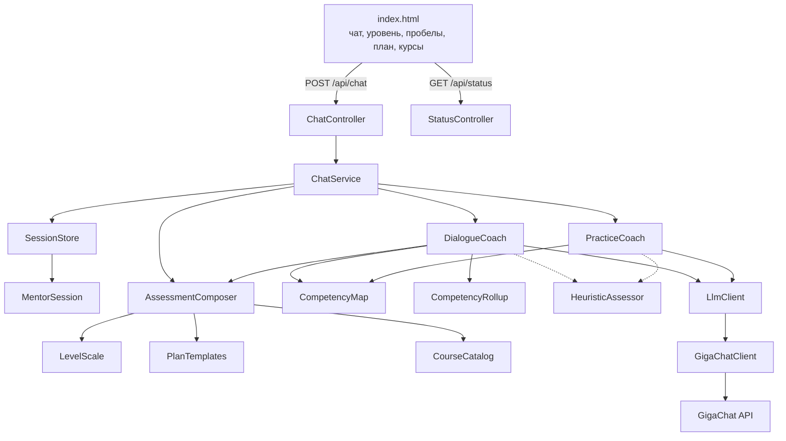

# Архитектура

Один процесс Spring Boot отдаёт и страницу, и API. Отдельного фронтенд-приложения нет. Сессии живут в памяти и пропадают при перезапуске. Учебные тексты выдуманы, внешних данных сотрудника нет.

## Слои

`StatusController` в чат не входит: он только проверяет, что три креды GigaChat заданы. `LlmAssessor` оставлен от старого сценария с фиксированными вопросами, текущий чат его не вызывает.



Стрелка означает вызов. Пунктир — запасной путь, если ключа нет или ответ модели не разобрался.

| Блок | Где в коде | За что отвечает |
| --- | --- | --- |
| index.html | `resources/static/index.html` | Единственная страница: чат, уровень, пробелы, план и курсы. Баллы не считает, отправляет реплику и рисует ответ сервера. Ответы наставника показываются как Markdown. |
| ChatController | `web/ChatController` | Принимает `POST /api/chat`: текст человека, номер сессии и, для тренажёра, действие «отработать» с кодом темы. |
| StatusController | `web/StatusController` | Принимает `GET /api/status` и отвечает только, заданы ли три креды GigaChat. В диалог и к модели не ходит. |
| ChatService | `web/ChatService` | Ведёт фазы: знакомство, диалог, бонусные кейсы, тренажёр, отчёт. Решает, кому отдать реплику, и собирает текст отчёта для страницы. |
| SessionStore | `dialog/SessionStore` | Держит все сессии в памяти. После перезапуска процесса они пропадают. |
| MentorSession | `dialog/MentorSession` | Одна сессия: роль, ответы, баллы, фаза, текущее задание тренажёра и готовый отчёт. |
| DialogueCoach | `llm/DialogueCoach` | Ведёт диагностику: 6–10 содержательных ответов, уточнение на слабый ответ, затем два бонусных кейса. Просит модель поставить балл 0–3 и не назначать уровень. |
| PracticeCoach | `llm/PracticeCoach` | Даёт упражнение по слабому месту и разбирает попытку. Тема закрывается, только когда названы все пункты задания. |
| CompetencyMap | `score/CompetencyMap` | Хранит тексты: пять тем и два бонусных кейса у каждой роли. Диалог и тренажёр берут формулировки отсюда. |
| CompetencyRollup | `score/CompetencyRollup` | Усредняет несколько оценок одной темы в один балл. Тема без ответов получает 0. |
| AssessmentComposer | `score/AssessmentComposer` | Собирает отчёт из баллов: сильные стороны, пробелы, план и курсы. Уровень берёт из шкалы. |
| LevelScale | `score/LevelScale` | Переводит долю набранных баллов в уровень: Новичок, Базовый, Уверенный, Продвинутый. |
| PlanTemplates | `score/PlanTemplates` | Строит четыре недели. Сначала слабые темы, потом закрепление тех, где балл уже 2 или 3. |
| CourseCatalog | `score/CourseCatalog` | Шесть заранее заданных курсов. Ссылку получает тема с баллом 0 или 1. Модель курсы не ищет. |
| LlmClient | `llm/LlmClient` | Общий вход «системная инструкция и текст человека, верни ответ». Диалог и тренажёр не зависят от конкретного адреса API. |
| GigaChatClient | `llm/GigaChatClient` | Реализует этот вход: получает токен Сбера и вызывает GigaChat API. |
| GigaChat API | внешний сервис | Возвращает балл и короткий разбор. Уровень, план и курсы остаются на стороне кода. |
| HeuristicAssessor | `score/HeuristicAssessor` | Подменяет модель, если ключа нет или ответ не разобрался как JSON. Балл ставится по длине текста и по словам вроде «проверю», «тест», «секрет». |

`llm/LlmAssessor`, `llm/AssessmentService` и `question/QuestionBank` остались от раннего сценария с фиксированными вопросами. Текущий чат их не вызывает.

## Модель

Креды читает `config/EnvFile` из `backend/.env` до старта Spring. Уже заданные переменные окружения файл не перетирает. Нужны `GIGACHAT_CLIENT_ID`, `GIGACHAT_SCOPE` и `GIGACHAT_AUTHORIZATION_KEY`. Имена и комментарии лежат в `backend/.env.example`. Сам `.env` в git не входит.

Клиент ходит за токеном на `https://ngw.devices.sberbank.ru:9443/api/v2/oauth` и за ответом на `https://api.giga.chat/v1/chat/completions`. Модель по умолчанию — `GigaChat-2`. Для TLS к хранилищу JVM добавлены корневой и промежуточный сертификаты Минцифры из `src/main/resources/certs/`.

`GET /api/status` возвращает только флаг `gigachatConnected`. Ключ в ответ не попадает. Боковая подпись на странице показывает «подключено» или «не подключено».

## Запуск

Нужна Java 25, в этом окружении это Temurin. Из каталога `backend`:

```bash
export JAVA_HOME=/Library/Java/JavaVirtualMachines/temurin-25.jdk/Contents/Home
mvn spring-boot:run
```

Страница открывается на `http://localhost:8080`. После правки кода или `.env` процесс нужно перезапустить: `spring-boot:run` изменения сам не подхватывает.
